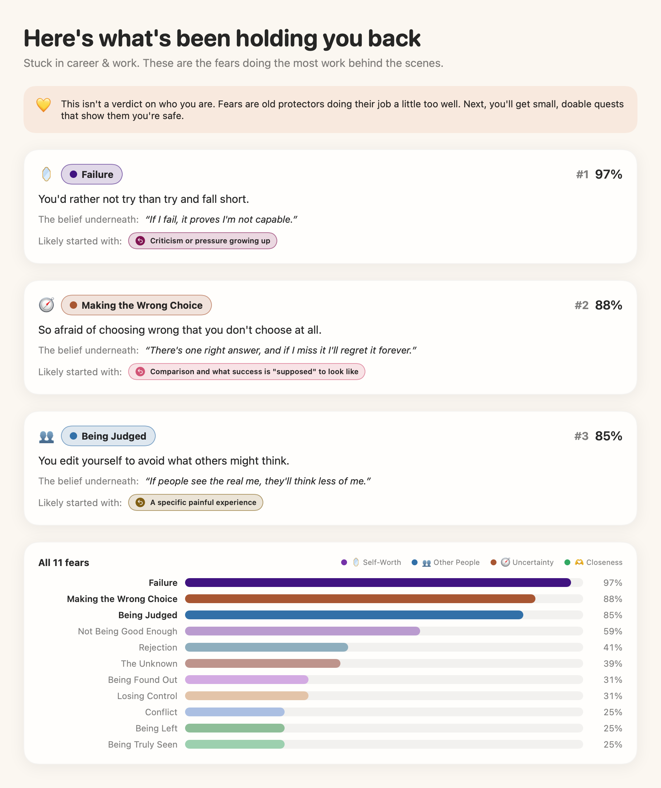
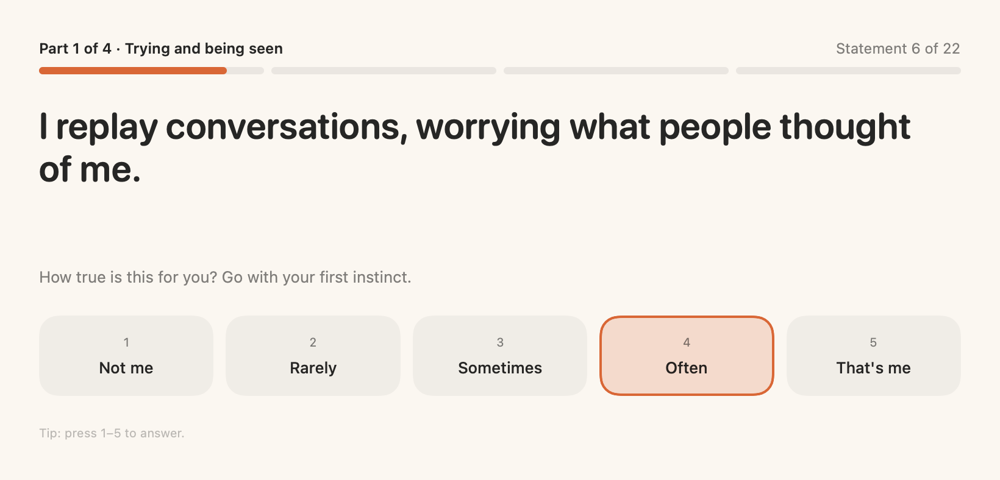
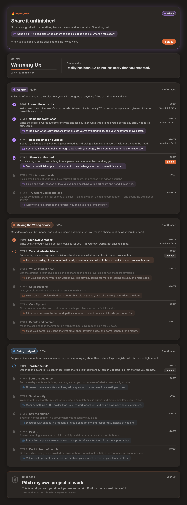
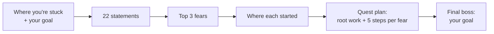
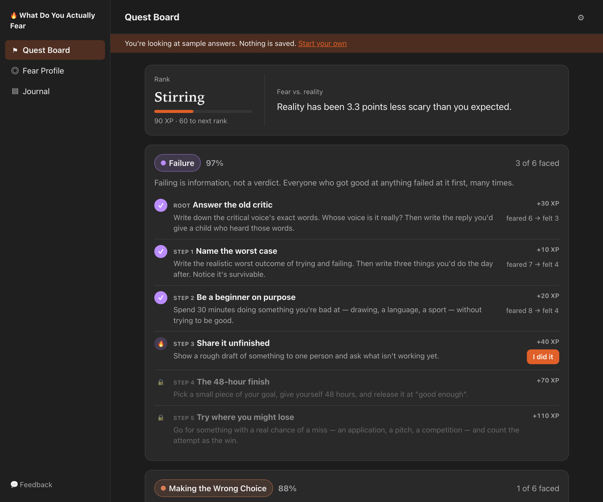

# What Do You Actually Fear

A Mac app and website that finds the fears keeping you stuck, works out where they came from, and turns facing them into a quest plan you play through, one small brave step at a time.

**[Try it in your browser →](https://amalmehta.github.io/WhatDoYouActuallyFear/)** · [see a demo with sample answers](https://amalmehta.github.io/WhatDoYouActuallyFear/?demo)

| Answer 22 quick statements | Then work through your quests |
|---|---|
|  |  |

**Links**

- [Website](https://amalmehta.github.io/WhatDoYouActuallyFear/)
- [How to set up, run and use it](docs/INSTRUCTIONS.md)
- [System design](docs/SYSTEM-DESIGN.md)
- [What's where in the code](docs/FILE-STRUCTURE.md)
