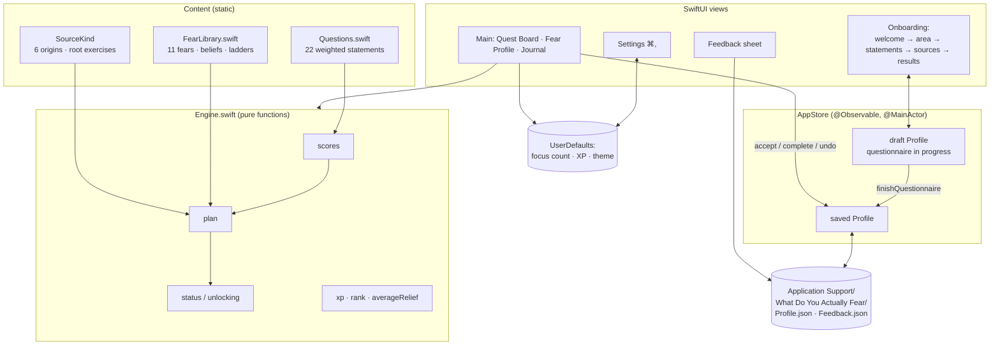

# System Design

## What it is

A native macOS SwiftUI app, fully offline. A questionnaire scores eleven fears, asks where the strongest ones came from, and builds a game plan from them: a root-cause exercise plus a graded exposure ladder for each fear, with XP, ranks and a final boss quest. Each quest is rated for predicted fear and actual fear, so the app can show how much less scary reality turned out to be.

## Architecture

## Components

| Component | Job |
|---|---|
| `Questions` | 22 first-person statements. Each carries weights for one to three fears. |
| `FearLibrary` | The content for each fear: name, family, shade, summary, how it keeps you stuck, core belief, reframe, and five escalating exposure quests. |
| `SourceKind` | Six possible origins of a fear: criticism, a painful event, learned from someone, instability, comparison, or unsure. Each has an explanation and a root exercise. |
| `Engine` | Pure, stateless logic. It turns answers into scores, scores and sources into a `GamePlan`, and works out each quest's status, total XP, rank and average relief. |
| `AppStore` | Holds the flow phase, the draft questionnaire and the saved profile. It moves through the questionnaire, records quest actions, and reads and writes JSON. |
| Views | Onboarding screens, a three-page sidebar app, a quest sheet, Settings and Feedback. Content views (`QuestBoardContent`, `RevealContent`, …) are kept separate from their scroll containers so they can be rendered to PNG. |
| `ScreenshotRenderer` | `--screenshots <dir>` renders the README images from sample data with `ImageRenderer`, then quits. |

## Main flows

1. **Questionnaire.** `start()` creates a draft, keeping the previous area and goal. `answer(n)` records 0–4 and moves forward. After the last statement the phase becomes `.sources`. `sourceFears` is the current top three. `nextSource()` → `finishQuestionnaire()` copies the draft into the saved profile, carrying over earlier completions and accepted quests, saves it, and shows the results.
2. **Scoring.** For each fear, score = Σ(answer × weight) ÷ Σ(4 × weight), shown as 0–100%. Results are sorted by score, and ties keep the library order, so the output is the same every time.
3. **Plan.** For the top *N* fears (Settings, 1–3), the plan has: a root quest (the chosen source's exercise, 30 XP), then five ladder steps (10/20/40/70/110 XP). It also has one boss quest (200 XP), built from the person's own goal, or a generic version if they left it blank.
4. **Playing.** Quests in a fear's plan unlock one at a time. **Accept** stores a predicted fear rating. **I did it** stores a `QuestCompletion` with the predicted rating, the actual rating and a note. The boss unlocks once every quest for any one fear is done. **Undo** removes either record.
5. **Retake.** Runs the questionnaire again. The journal and quest progress are kept, because quest ids are stable (`<fear>.source`, `<fear>.step3`, `boss`).

## Where data lives

- `~/Library/Application Support/What Do You Actually Fear/Profile.json`: the whole `Profile`, as pretty-printed JSON with ISO-8601 dates (stored to the whole second, so what's in memory matches what reloads).
- `.../Feedback.json`: an array of `FeedbackEntry`. **Erase everything** keeps it.
- `UserDefaults`: `focusCount`, `showXP`, `appearance`.

## Key decisions and trade-offs

| Decision | Why | Trade-off |
|---|---|---|
| Offline, rule-based engine (no AI) | Private, free, instant and predictable; answers about fears are sensitive | Less personal than written analysis. The plan's wording is fixed per fear and source, and only the boss quest uses your own words |
| Weighted Likert scoring over 11 fears in 4 families | Simple, explainable and easy to test; statements can point to more than one fear | Not a validated clinical instrument. It's meant for reflection, not diagnosis |
| Graded exposure ladders, plus a root exercise per source | Facing a fear in small, escalating steps is the core idea behind exposure work; the root quest covers "where it came from" | The steps are general, not tailored to each life area |
| Predicted vs. actual fear rating | Turns each quest into evidence that fear overestimates; this is what "fear vs. reality" shows | Relies on honest self-rating |
| Sequential unlocking with XP and ranks | Adds a game loop and stops people from skipping to the hardest step | Some people may want to jump ahead; they can't yet |
| One JSON file, no database | Tiny data, easy to inspect and back up | No sync between Macs |
| Colors from hue families, worked out in code | Related fears share a hue and differ in shade (hue ±0.025, saturation and brightness), with separate tuning for light and dark | Shades within a family are close by design; labels always go with them |
| XcodeGen project | A readable `project.yml` instead of a hand-edited pbxproj | Needs `xcodegen` installed to change targets |
| Swift 5 language mode, macOS 14+ | Uses `@Observable`, `SettingsLink` and `ContentUnavailableView` without Swift 6 strict-concurrency friction | Doesn't run on macOS 13 or earlier |

## Testing

`xcodebuild … test` runs 17 XCTest cases:

- **EngineTests:** every fear has five ladder steps and at least two statements; question ids are unique; shades don't collide within a family; scores are 0% for all-zero answers and 100% for all-max answers; the right fear comes out on top for targeted answers; out-of-range answers are clamped; plan shape and focus clamping; the root quest follows the chosen source; unlocking order; boss unlocking; the boss uses your goal or a fallback; XP, ranks and average relief.
- **StoreTests** (temporary folder): a fresh start; the full questionnaire saves and reloads identically; back navigation; accept, complete and undo persist; retake keeps the journal; erase plus feedback.

Visual check: the `--screenshots` renders in `docs/images/` (light and dark). The live UI (clicks, sheets, keyboard shortcuts) has not been click-tested yet: no UI test target exists, and the first build was verified through logic tests and rendered screens only.

## Known limits

- The content is written for general adult self-reflection. It isn't clinically validated and isn't a replacement for therapy.
- English only. The 22 statements and 11 fears are fixed; there's no custom fear.
- Quest steps aren't tailored to the chosen life area. The area shows up only in text and the fallback boss.
- No reminders, notifications, export or sync.
- Feedback is saved locally and isn't sent anywhere.
- The app is ad-hoc signed and not notarized, so on another Mac Gatekeeper will ask you to confirm the first time it opens (right-click → Open).
- The website version hasn't been built yet. It's the next step after the Mac app.
