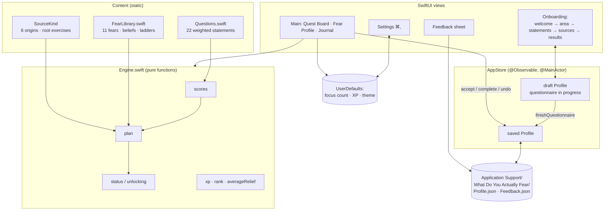
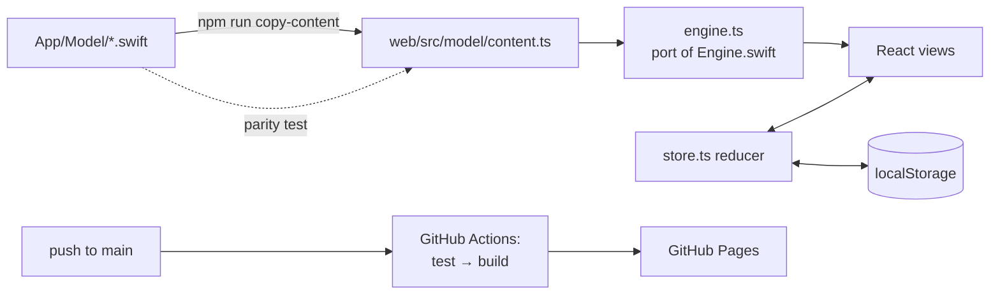

# System Design

## What it is

Two front ends with the same content and rules: a native macOS SwiftUI app and a React website on GitHub Pages. Both work offline and keep everything on the device. A questionnaire scores eleven fears, asks where the strongest ones came from, and builds a game plan from them: a root-cause exercise plus a graded exposure ladder for each fear, with XP, ranks and a final boss quest. Each quest is rated for predicted fear and actual fear, so the app can show how much less scary reality turned out to be.

## Architecture

### Website

The website is a single-page React app with no backend. `App.tsx` holds state in a `useReducer` (`store.ts`, which mirrors `AppStore`) and saves the profile and settings to localStorage after every change. `engine.ts` is a line-for-line port of `Engine.swift`. Colors come from the same HSB formula, turned into CSS variables for light and dark. `?demo` loads the same sample profile as the Mac app's screenshot renderer and never saves.

## Components

| Component | Job |
|---|---|
| `Questions` | 22 first-person statements. Each carries weights for one to three fears. |
| `FearLibrary` | The content for each fear: name, family, shade, summary, how it keeps you stuck, core belief, reframe, and five escalating exposure quests. |
| `AreaExamples` | 385 hand-written examples: for every fear, life area and ladder step, one concrete line showing what that step looks like in that area. The engine attaches the chosen area's example to each step quest. |
| `SourceKind` | Six possible origins of a fear: criticism, a painful event, learned from someone, instability, comparison, or unsure. Each has an explanation and a root exercise. |
| `Engine` | Pure, stateless logic. It turns answers into scores, scores and sources into a `GamePlan`, and works out each quest's status, total XP, rank and average relief. |
| `AppStore` | Holds the flow phase, the draft questionnaire and the saved profile. It moves through the questionnaire, records quest actions, and reads and writes JSON. |
| Views | Onboarding screens, a three-page sidebar app, a quest sheet, Settings and Feedback. Content views (`QuestBoardContent`, `RevealContent`, …) are kept separate from their scroll containers so they can be rendered to PNG. |
| `ProgressFile` / `progress.ts` | The progress file shared by both apps: a `Profile` as JSON with sorted keys and whole-second ISO 8601 dates. Decoding checks every field and gives a plain-language reason when a file is rejected. The Mac decoder also accepts millisecond dates. |
| `ProgressTransfer` (both apps) | Export and import: the file picker, the export download or save panel, dropping a file anywhere on the window, pasting with ⌘V when no text field is being edited, a preview, and confirmation before replacing. |
| `ScreenshotRenderer` | `--screenshots <dir>` renders the README images from sample data with `ImageRenderer`, then quits. |

| `web/scripts/swift-content.mjs` | Parses the Swift content files. It's used to copy the content into `content.ts` and by the parity test. |
| `web/src/model/*` | The website's content copy, engine, reducer, theme and demo data. |
| `web/src/views/*` | The website's screens: onboarding, main shell, quest dialog, settings and feedback. |
| `.github/workflows/pages.yml` | On every push to `main`: `npm ci`, run the tests, build, and deploy to Pages. |
| `.github/workflows/mac-tests.yml` | When the Mac app's files change (push to `main` or a pull request), or on demand: build on a `macos-26` runner, then run the unit tests and the UI tests. Uploads the `.xcresult` bundles if anything fails. |

## Main flows

1. **Questionnaire.** `start()` creates a draft, keeping the previous area and goal. `answer(n)` records 0–4 and moves forward. After the last statement the phase becomes `.sources`. `sourceFears` is the current top three. `nextSource()` → `finishQuestionnaire()` copies the draft into the saved profile, carrying over earlier completions and accepted quests, saves it, and shows the results.
2. **Scoring.** For each fear, score = Σ(answer × weight) ÷ Σ(4 × weight), shown as 0–100%. Results are sorted by score, and ties keep the library order, so the output is the same every time.
3. **Plan.** For the top *N* fears (Settings, 1–3), the plan has: a root quest (the chosen source's exercise, 30 XP), then five ladder steps (10/20/40/70/110 XP). It also has one boss quest (200 XP), built from the person's own goal, or a generic version if they left it blank.
4. **Playing.** Quests in a fear's plan unlock one at a time. **Accept** stores a predicted fear rating. **I did it** stores a `QuestCompletion` with the predicted rating, the actual rating and a note. The boss unlocks once every quest for any one fear is done. **Undo** removes either record.
5. **Retake.** Runs the questionnaire again. The journal and quest progress are kept, because quest ids are stable (`<fear>.source`, `<fear>.step3`, `boss`).

6. **Export and import.** Export writes the current profile as the progress file. Import (from the picker, a drop or a paste) parses and validates the file, then shows a preview (date, top fear, quests done). Confirming replaces the profile, saves it, and opens the Quest Board. Cancel changes nothing. On the website, importing also ends demo mode, so the imported progress is saved.

## Where data lives

Mac app:

- `~/Library/Application Support/What Do You Actually Fear/Profile.json`: the whole `Profile`, as pretty-printed JSON with ISO-8601 dates (stored to the whole second, so what's in memory matches what reloads).
- `.../Feedback.json`: an array of `FeedbackEntry`. **Erase everything** keeps it.
- `UserDefaults`: `focusCount`, `showXP`, `appearance`.

Website: localStorage keys `wdyaf.profile` (same shape as `Profile.json`), `wdyaf.settings` and `wdyaf.feedback`. If storage is blocked, a banner says progress won't be saved.

## Key decisions and trade-offs

| Decision | Why | Trade-off |
|---|---|---|
| Offline, rule-based engine (no AI) | Private, free, instant and predictable; answers about fears are sensitive | Less personal than written analysis. The plan's wording is fixed per fear and source, and only the boss quest uses your own words |
| Weighted Likert scoring over 11 fears in 4 families | Simple, explainable and easy to test; statements can point to more than one fear | Not a validated clinical instrument. It's meant for reflection, not diagnosis |
| Graded exposure ladders, plus a root exercise per source | Facing a fear in small, escalating steps is the core idea behind exposure work; the root quest covers "where it came from" | The steps are general, not tailored to each life area |
| Predicted vs. actual fear rating | Turns each quest into evidence that fear overestimates; this is what "fear vs. reality" shows | Relies on honest self-rating |
| Sequential unlocking with XP and ranks | Adds a game loop and stops people from skipping to the hardest step | Some people may want to jump ahead; they can't yet |
| One JSON file, no database | Tiny data, easy to inspect and back up | No sync between Macs |
| Colors from hue families, worked out in code | Related fears share a hue and differ in shade (hue ±0.025, saturation and brightness), with separate tuning for light and dark | Shades within a family are close by design; labels always go with them |
| XcodeGen project | A readable `project.yml` instead of a hand-edited pbxproj | Needs `xcodegen` installed to change targets |
| Website content is copied from the Swift, not shared | The Mac app stays untouched; the website stays a plain static build | Two copies. `copy-content` regenerates the web copy and the parity test (also run in CI) fails if they drift |
| React + Vite on GitHub Pages, no backend | Free static hosting; answers never leave the browser | No accounts or sync; clearing site data erases progress |
| An area example under each step, rather than rewriting steps per area | Every step feels specific to where you're stuck, and the general wording still explains the step itself. Quest ids don't depend on the area, so progress carries over if you retake with a different one | 385 lines to maintain. Tests check every fear and area has 5 distinct examples of 140 characters or fewer |
| One progress-file format: the existing Profile JSON | Moves both ways between the website and the Mac app with no conversion; the Mac app's own `Profile.json` can be imported too | No version field yet. A future format change would need one |
| Import replaces after confirmation (no merging) | Simple and predictable | Two separate journals can't be combined |
| Website feedback saved locally, with an optional GitHub issue | There's no server to send it to | Only feedback that people choose to post as an issue reaches the developer |
| Swift 5 language mode, macOS 14+ | Uses `@Observable`, `SettingsLink` and `ContentUnavailableView` without Swift 6 strict-concurrency friction | Doesn't run on macOS 13 or earlier |

## Testing

`xcodebuild … test` runs 22 unit tests and 9 UI tests.

Unit tests:

- **EngineTests:** every fear has five ladder steps and at least two statements; question ids are unique; shades don't collide within a family; scores are 0% for all-zero answers and 100% for all-max answers; the right fear comes out on top for targeted answers; out-of-range answers are clamped; plan shape and focus clamping; the root quest follows the chosen source; unlocking order; boss unlocking; the boss uses your goal or a fallback; XP, ranks and average relief.
- **ProgressFileTests:** `Tests/Fixtures/Progress from Mac.json` is byte-for-byte what this app writes; the website's export of the same profile decodes identically; millisecond dates are accepted; bad files are rejected with the right message; preview changes nothing; import replaces and persists. The website tests read the Mac fixture and write the website fixture, so each app is checked against the other's real output.
- **StoreTests** (temporary folder): a fresh start; the full questionnaire saves and reloads identically; back navigation; accept, complete and undo persist; retake keeps the journal; erase plus feedback.

UI tests (`UITests/`, XCUITest) launch the real app with `-UITestDataDirectory` pointing at a temporary folder, and find controls by accessibility identifiers (`begin`, `answer-0…4`, `source-<id>`, `questAction-<quest id>`, `questPrimary`, `ratingSlider`, …):

- **Full flow:** the whole questionnaire by clicks and keys 1–5, then sources, results, accepting a quest with a fear rating, and finishing it with a lower rating and a note. It checks the saved `Profile.json` and the Journal.
- **Reopening:** saved progress opens on the Quest Board with the accepted quest kept. **Back** (⌘[) keeps the earlier answer. **⌘,** opens Settings with Export and Import.
- **Import and export:** pasting a website progress file with ⌘V imports it after confirmation; pasting other JSON explains why it can't. The welcome-screen link opens the system open panel, and File → Export Progress… opens the save panel (both cancelled, so nothing is written outside the temporary folder). **Erase everything** returns to the welcome screen and deletes the profile.

The tests wait for each statement before answering it, and fill text fields by pasting, because typing quickly into SwiftUI controls can drop keys. Both the unit and UI tests also run in GitHub Actions (`mac-tests.yml`) on a hosted `macos-26` runner with Xcode 26.6. The whole job takes about 4 minutes.

Drag and drop of a file isn't covered: XCUITest can't drag files in from Finder. That path is covered by the website's tests and the shared import code.

`npm --prefix web test` runs 36 Vitest cases:

- **parity:** families, fears, sources, life areas, the answer scale, questions and weights, and XP and ranks all match the Swift exactly.
- **engine:** the same cases as EngineTests, plus color checks (every fear and source color is distinct in light and dark mode).
- **progress** (10): reads the Mac app's file; writes exactly `Tests/Fixtures/Progress from Website.json`; round-trips and drops milliseconds; rejects bad files with clear reasons; import from the welcome-screen picker; replacing asks first and Cancel keeps progress; drop anywhere; paste works on the page but not inside a text field; a bad file shows an error; export from the sidebar.
- **app** (jsdom + Testing Library): the full questionnaire by clicks and number keys, then results, accept, complete, the journal and saving; reloading restores progress; back navigation keeps answers; Ctrl+, opens Settings, and the focus count, XP and theme apply; demo mode doesn't save; erase; feedback saves and builds the GitHub issue link.

The website was also clicked through in a real browser (keyboard questionnaire, sources, results, the quest dialog) and checked at phone width for horizontal overflow.

Visual check: the `--screenshots` renders in `docs/images/` (light and dark). The live UI (clicks, sheets, keyboard shortcuts) has not been click-tested yet: no UI test target exists, and the first build was verified through logic tests and rendered screens only.

## Known limits

- The content is written for general adult self-reflection. It isn't clinically validated and isn't a replacement for therapy.
- English only. The 22 statements and 11 fears are fixed; there's no custom fear.
- Each ladder step keeps its general wording and gets one fixed example for the chosen area. The root and boss quests have none: the root comes from where the fear started, and the boss is your own goal. Changing area means retaking the questionnaire.
- No reminders, notifications or automatic sync. Moving progress means exporting and importing a file by hand.
- Feedback is saved locally and isn't sent anywhere.
- The app is ad-hoc signed and not notarized, so on another Mac Gatekeeper will ask you to confirm the first time it opens (right-click → Open).
- The website and the Mac app keep separate progress until you export from one and import into the other.
- Rounding differs for a relief value that ends in exactly .x5. For example, an average of 3.25 shows as "3.2" in the Mac app (printf rounds half to even) and "3.3" on the website (JavaScript's `toFixed`).
- In the browser, ⌘, may be taken by the browser itself. The gear button always works.
- The Mac UI tests don't cover dropping a file onto the window, or actually choosing a file in the open or save panel (they open the panels and cancel). They need a desktop session, which GitHub's hosted macOS runners provide.
